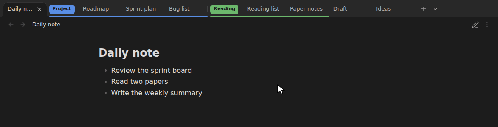
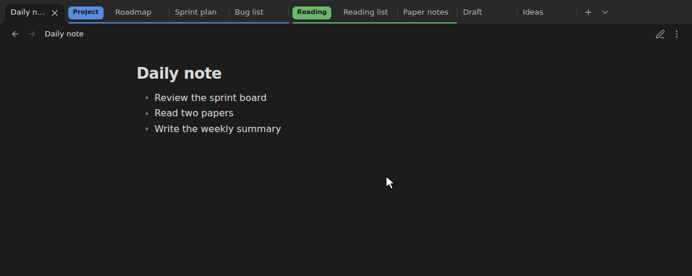
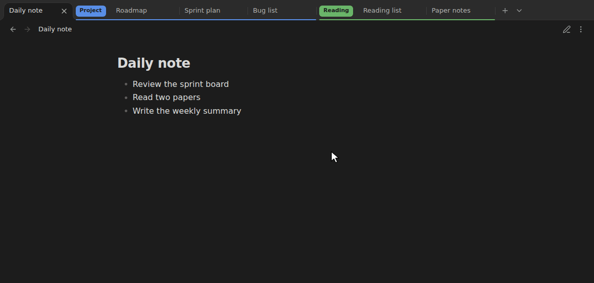

# Tab Groups

[English](../README.md) | 한국어

옵시디언에 크롬 스타일의 탭 그룹을 더합니다. 관련 탭에 이름과 색을 붙여 묶고, 공간이 필요하면 접어 두세요.


- 🏷️ **묶기** · 탭 우클릭 → **새 탭 그룹 만들기**. 이름과 색을 고르세요.
- 📁 **접기** · 라벨을 클릭하면 그룹의 탭이 숨고, 다시 클릭하면 돌아옵니다.
- ✋ **옮기기** · 라벨을 끌면 그룹이 통째로 옮겨집니다. 다른 창으로도 됩니다.
- 💾 **유지** · 옵시디언을 다시 켜도 그룹과 접힘 상태가 그대로입니다.

## ✨ 주요 기능
---
* **색상과 라벨이 있는 그룹:** 탭 묶음에 이름과 색상을 붙입니다. 그룹 앞에는 라벨이 붙고, 그룹에 속한 탭들은 같은 색 줄로 이어집니다.
* **접기/펼치기:** 그룹 라벨을 클릭하면 그룹의 탭이 숨겨져 공간이 생깁니다. 다시 클릭하면 원래 순서대로 나타납니다. 탭을 넘길 때는 접힌 그룹을 건너뜁니다.
* **드래그 앤 드롭:** 탭 하나나 그룹 전체(라벨을 잡고)를 끌어 옮길 수 있습니다. 놓일 자리는 빈칸(플레이스홀더)으로 미리 보여 주고, 그 자리에 놓으면 그룹에 들어갈 때는 그 그룹 색으로 보여 줍니다. 그룹을 창 가장자리에 놓으면 창을 분할하고, 다른 창의 탭 바에 놓으면 그 창으로 옮깁니다.

  

* **탭을 옮기면 그룹에 자동 편입·이탈:** 크롬처럼 탭을 펼쳐진 그룹 안으로 옮기면 그 그룹에 들어가고, 밖으로 옮기면 빠집니다. 드래그뿐 아니라 [Pane Relief](https://github.com/pjeby/pane-relief)의 탭 이동(swap) 같은 단축키 이동에서도 동작합니다. 접힌 그룹은 한 덩어리로 건너뜁니다.
* **파일 탐색기에서 열기:** 접힌 그룹 안에 이미 열려 있는 노트를 탐색기에서 클릭하면, 새 탭을 열지 않고 그룹을 펼쳐 그 탭으로 이동합니다.
* **상태 보존:** 그룹, 색상, 속한 탭, 접힘 상태가 옵시디언을 다시 열어도 그대로 복구됩니다.
* **그룹 숨기기·다시 열기:** 크롬처럼 그룹을 숨기면 탭은 닫히고 그룹은 남습니다. 나중에 설정이나 명령어 팔레트에서 다시 열면 탭이 원래 순서대로 돌아옵니다. 노트 이름이 바뀌어도 따라갑니다.
* **닫은 탭을 그룹으로 다시 열기:** 크롬처럼 **닫은 탭 다시 열기**(Ctrl+Shift+T)로 연 탭이 원래 그룹의 원래 자리로 돌아옵니다. 그룹을 통째로 숨기거나 삭제했다면 그룹이 탭과 함께 모두 돌아옵니다.

  

* **그룹 세트:** 작업 공간처럼 지금 그룹들(이름, 색, 접힘 상태, 탭)을 이름 붙여 세트로 저장했다가 나중에 다시 엽니다. 노트 이름이 바뀌어도 따라갑니다.
* **10개 언어 지원:** 탭 메뉴와 그룹 창은 기본으로 옵시디언 언어를 따릅니다. 플러그인 설정에서 직접 고를 수도 있습니다. 다른 언어로 [번역에 참여](./translating-ko.md)해 주세요!
* **팝업 창 지원:** 별도로 띄운 팝업 창에서도 그룹이 표시되고 유지됩니다.
* **[Vertical Tabs](https://github.com/oxdc/obsidian-vertical-tabs)와 함께 쓰기:** 그 플러그인의 세로 탭 목록에서도 그룹 탭은 설정한 그룹 표시 모양대로 그룹 색이 칠해지고, 그룹 첫 탭 위에는 그룹 이름과 탭 수가 적힌 머리줄로 보입니다. 머리줄을 누르면 접고 펼치며, 우클릭하면 그룹 창이 열립니다. 목록에서 탭을 우클릭하면 탭 바 메뉴처럼 그룹 항목(그룹에서 제외, 다른 그룹에 넣기, 새 탭 그룹 만들기)이 보입니다. 목록에서 탭을 끌면 탭 바처럼 들어갈 자리가 보이고, 그룹에 들어가는 자리면 그룹 색으로 보입니다. 자리는 탭 바처럼 커서로 정해, 줄(그룹 머리줄 포함)의 가운데를 넘으면 그 줄 뒤입니다. 그룹 맨 끝에서는 마지막 탭의 아래쪽 절반이면 편입, 그보다 아래면 그룹 밖입니다.

## 🚀 사용법
---
1. 탭을 우클릭하고 **새 탭 그룹 만들기**를 선택합니다. 이름(선택)을 적고 색상을 고릅니다.
2. 다른 탭을 넣으려면 그 탭을 우클릭해 **"그룹 이름" 그룹에 넣기**를 선택하거나, 그룹 안으로 끌어다 놓습니다. 그룹에서 빼려면 **그룹에서 제외**를 선택하거나 그룹 밖으로 끌어냅니다.
3. 그룹 라벨을 클릭하면 접히거나 펼쳐집니다. 라벨을 우클릭하면 이름·색상을 바꾸거나 다음을 할 수 있습니다.
    * **그룹 숨기기:** 탭은 닫고 그룹은 남겨 나중에 다시 엽니다.
    * **그룹 해제:** 탭은 일반 탭으로 남기고 그룹을 없앱니다.
    * **그룹 삭제:** 탭을 닫고 그룹도 삭제합니다 (먼저 확인합니다).
    * **그룹에 새 탭:** 그룹 끝에 새 탭을 엽니다.
    * **새 창으로 옮기기:** 그룹을 탭째로 새 창으로 옮깁니다.

### 명령어
명령어 팔레트에서 실행하거나 **설정 → 단축키**에서 단축키를 지정할 수 있습니다. 대부분 현재 탭을 기준으로 동작합니다.

* **현재 탭으로 새 탭 그룹 만들기**
* **그룹 없는 탭을 모두 새 그룹으로** (지금 창에서 그룹에 들지 않은 탭들)
* **폴더별로 탭 그룹 만들기** (지금 창에서 그룹 없는 탭이 2개 이상인 폴더마다, 폴더 이름으로 그룹을 만듦)
* **현재 탭을 그룹에 넣기** (목록에서 그룹 선택)
* **현재 탭을 그룹에서 제외**
* **현재 탭의 그룹 접기·펼치기**
* **현재 탭의 그룹 편집**
* **현재 탭의 그룹에 새 탭 열기**
* **현재 탭의 그룹을 새 창으로 옮기기**
* **숨긴 그룹 다시 열기** (목록에서 그룹 선택)
* **현재 탭의 그룹 숨기기**
* **모든 그룹 접기** / **모든 그룹 펼치기**
* **다음 그룹으로 이동** / **이전 그룹으로 이동** (같은 창에서 다음·이전 그룹의 첫 탭으로, 끝에서는 반대쪽 끝으로 돌아감. 접힌 그룹이면 펼쳐짐)
* **지금 그룹들을 세트로 저장** / **저장한 그룹 세트 열기** / **저장한 그룹 세트 삭제** (열면 세트의 그룹들을 지금 창 끝에 엶. 이미 있는 이름으로 저장하면 그 세트를 바꿈)

## ⚙️ 설정
---
**설정 → 커뮤니티 플러그인 → Tab Groups**에서 바꿀 수 있습니다.



* **언어:** 자동(옵시디언 언어), English, Deutsch, Español, Français, Português (Brasil), Русский, 日本語, 한국어, 简体中文, 繁體中文 중에서 고릅니다.
* **그룹 표시 모양:** **밑줄**(기본)은 작은 라벨과 그룹 탭 아래 색 밑줄로 보여 줍니다. **클래식**은 탭 위쪽 색 줄과 옅은 배경으로 보여 줍니다.

  <picture>
    <source media="(prefers-color-scheme: dark)" srcset="./images/group-styles-dark.png">
    
  </picture>

* **그룹 라벨에 탭 개수:** **끄기**(기본), **접힌 그룹만**, **모든 그룹** 중에서 고릅니다. 그룹 이름 옆에 그 그룹의 탭 수를 보여 주며, 접힌 그룹은 숨은 탭까지 셉니다.
* **마지막 탭을 닫으면 그룹 삭제:** 기본은 꺼짐입니다. 켜면 그룹의 마지막 탭을 닫을 때 크롬처럼 그룹도 지웁니다. 끄면 그룹이 남아 있어 나중에 다시 탭을 넣을 수 있습니다. 숨긴 그룹은 지우지 않습니다.
* **그룹 탭 잠금:** 기본은 꺼짐입니다. 켜면 그룹 탭에서 연 노트(링크, 파일 탐색기, 빠른 전환기)가 그 탭을 바꾸지 않고 그룹 밖의 새 탭에 열려, 그룹 탭의 노트가 그대로 남습니다. 새 탭도 탭 메뉴에서 그룹에 넣으면 잠깁니다. 탭을 고정하지 않으므로 탭 위치는 그대로입니다. 그룹 탭 안에서 뒤로·앞으로 가기를 하면 노트가 바뀌고, 메인 창의 탭만 잠깁니다.
* **새 그룹의 이름과 색 제안:** 기본은 꺼짐입니다. 켜면 새 그룹 창에 탭 노트가 있는 폴더 이름을 미리 채우고, 그 이름에서 색을 골라 같은 폴더면 늘 같은 색이 되게 합니다(다른 그룹이 그 색을 쓰고 있으면 다른 색). 보관함 맨 위의 노트는 이름을 채우지 않습니다. 둘 다 바꿀 수 있습니다.
* **탭 그룹:** 모든 그룹과 열린 탭 수를 보여 줍니다. 숨긴 그룹은 기억한 탭 수와 **다시 열기** 버튼이 나옵니다. 더 쓰지 않는 그룹은 **그룹 삭제**를 눌러 지우세요.
* **그룹 세트:** 저장한 세트와 그 안의 그룹·탭 수를 보여 줍니다. **새 세트**에 이름을 적고 **지금 그룹 저장**을 누르면 지금 그룹들을 세트로 저장합니다(이미 있는 이름이면 그 세트를 바꿈). **열기**는 세트의 그룹들을 지금 창 끝에 열며, **세트 삭제**는 세트를 지웁니다(열린 탭은 그대로).

## 📝 동작 범위
---
| | 되는 것 | 안 되거나 확인 안 된 것 |
|---|---|---|
| **탭** | 노트 탭, 빈 탭, 그래프 뷰 같은 다른 화면 | 사이드바(왼쪽·오른쪽 패널) 탭은 묶을 수는 있지만 충분히 확인하지 않음 |
| **창** | 메인 창과 팝업 창. 라벨을 끌어 그룹째 다른 창으로 옮기기 | |
| **탭 옮기기** | 드래그, [Pane Relief](https://github.com/pjeby/pane-relief)의 탭 이동(swap) 같은 단축키 이동 | |
| **배치** | 일반 탭 바, 탭 쌓기(Stacked tabs) 모드 (그룹 막대를 그룹 색으로 칠하고 첫 막대에 그룹 이름을 보여 줌) | 탭 쌓기 모드에서 그룹 접기: 그 모드에서는 탭이 그대로 보이고, 일반 탭 바로 돌아오면 다시 접힘 |
| **플랫폼** | 데스크톱 | 모바일 |

탭 하나만 다른 창으로 옮기면 크롬처럼 그 탭은 그룹에서 빠지고, 그룹은 원래 창에 남습니다.

## 🛠️ 설치 방법
---
**설정 → 커뮤니티 플러그인 → 찾아보기**에서 **Tab Groups**를 검색한 뒤 **설치**, **활성화**를 누릅니다.

### 수동 설치
1. [최신 릴리스](https://github.com/imsang27/obsidian-tab-groups/releases/latest)에서 `main.js`, `manifest.json`, `styles.css`를 내려받습니다.
2. 보관함 안에 `.obsidian/plugins/tab-groups/` 폴더를 만들고 내려받은 파일을 넣습니다.
3. 옵시디언을 다시 시작한 뒤 **설정 → 커뮤니티 플러그인**에서 **Tab Groups**를 켭니다.

## 💻 개발자 가이드
---
이 프로젝트는 옵시디언 공식 샘플 플러그인 템플릿을 바탕으로 만들었습니다.

1. 테스트 보관함의 `.obsidian/plugins/` 폴더 안에 이 저장소를 클론합니다.
2. 의존성 패키지를 설치합니다:
    ```bash
    npm install
    ```
3. 코드가 바뀔 때마다 다시 빌드되도록 감시 모드로 실행합니다:
    ```bash
    npm run dev
    ```

## 🌐 번역
---
| 언어 | 상태 |
| --- | --- |
| 한국어 | 관리자가 직접 작성 (모국어) |
| English, Deutsch, Español, Français, Português (Brasil), Русский, 日本語, 简体中文, 繁體中文 | AI의 도움을 받아 작성, 아직 원어민 검토 전 |

> [!NOTE]
> 원어민이 쓴 문구는 한국어뿐입니다. 영어를 포함한 나머지 언어는 AI의 도움을 받아 작성했고 아직 원어민 검토를 받지 않아 **정확하지 않을 수 있습니다.** 어색하거나 틀린 문구가 있으면 고쳐 주세요.

번역 기여를 환영합니다! 언어마다 [`src/i18n/locales/`](../src/i18n/locales/)에 작은 JSON 파일 하나뿐이라, 아무것도 설치하지 않고 깃허브에서 바로 고칠 수 있습니다.

* **번역 고치기:** 그 언어의 파일을 열고 연필 아이콘(**Edit this file**)을 눌러 문구를 고친 뒤 변경을 제안하세요. 깃허브가 풀 리퀘스트를 대신 만들어 줍니다.
* **새 언어 추가:** `en.json`을 복사해 언어 코드 이름으로 새 파일을 만들고 번역하세요.
* **풀 리퀘스트가 어렵다면:** [번역 이슈](https://github.com/imsang27/obsidian-tab-groups/issues/new?template=translation.yml)를 열고 고칠 내용이나 번역을 적어 주세요.

빠진 문구는 영어로 보이니 일부만 번역해도 괜찮습니다. 자세한 내용은 [번역 가이드](./translating-ko.md)를 참고하세요.

## 🤝 기여하기
---
버그 제보, 아이디어, 번역, 코드 모두 환영합니다. [기여 가이드](./contributing-ko.md)를 참고하세요.

## 📄 라이선스
---
이 플러그인은 [MIT 라이선스](../LICENSE)를 따릅니다.
