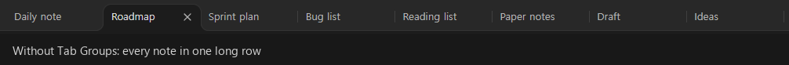
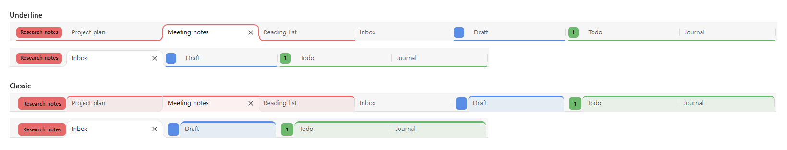

# Tab Groups

[English](../README.md) | 한국어

옵시디언에 크롬 스타일의 탭 그룹을 더합니다. 관련 탭에 이름과 색을 붙여 묶고, 공간이 필요하면 접어 두세요.



- 🏷️ **묶기** · 탭 우클릭 → **새 탭 그룹 만들기**. 이름과 색을 고르세요.
- 📁 **접기** · 라벨을 클릭하면 그룹의 탭이 숨고, 다시 클릭하면 돌아옵니다.
- ✋ **옮기기** · 라벨을 끌면 그룹이 통째로 옮겨집니다. 다른 창으로도 됩니다.
- 💾 **유지** · 옵시디언을 다시 켜도 그룹과 접힘 상태가 그대로입니다.

## ✨ 주요 기능
---
* **색상과 라벨이 있는 그룹:** 탭 묶음에 이름과 색상을 붙입니다. 그룹 앞에는 라벨이 붙고, 그룹에 속한 탭들은 같은 색 줄로 이어집니다.
* **접기/펼치기:** 그룹 라벨을 클릭하면 그룹의 탭이 숨겨져 공간이 생깁니다. 다시 클릭하면 원래 순서대로 나타납니다. 탭을 넘길 때는 접힌 그룹을 건너뜁니다.
* **드래그 앤 드롭:** 탭 하나나 그룹 전체(라벨을 잡고)를 끌어 옮길 수 있습니다. 놓일 자리는 빈칸(플레이스홀더)으로 미리 보여 줍니다. 그룹을 창 가장자리에 놓으면 창을 분할하고, 다른 창의 탭 바에 놓으면 그 창으로 옮깁니다.
* **탭을 옮기면 그룹에 자동 편입·이탈:** 크롬처럼 탭을 펼쳐진 그룹 안으로 옮기면 그 그룹에 들어가고, 밖으로 옮기면 빠집니다. 드래그뿐 아니라 [Pane Relief](https://github.com/pjeby/pane-relief)의 탭 이동(swap) 같은 단축키 이동에서도 동작합니다. 접힌 그룹은 한 덩어리로 건너뜁니다.
* **파일 탐색기에서 열기:** 접힌 그룹 안에 이미 열려 있는 노트를 탐색기에서 클릭하면, 새 탭을 열지 않고 그룹을 펼쳐 그 탭으로 이동합니다.
* **상태 보존:** 그룹, 색상, 속한 탭, 접힘 상태가 옵시디언을 다시 열어도 그대로 복구됩니다.
* **10개 언어 지원:** 탭 메뉴와 그룹 창은 기본으로 옵시디언 언어를 따릅니다. 플러그인 설정에서 직접 고를 수도 있습니다. 다른 언어로 [번역에 참여](./translating-ko.md)해 주세요!
* **팝업 창 지원:** 별도로 띄운 팝업 창에서도 그룹이 표시되고 유지됩니다.

## 🚀 사용법
---
1. 탭을 우클릭하고 **새 탭 그룹 만들기**를 선택합니다. 이름(선택)을 적고 색상을 고릅니다.
2. 다른 탭을 넣으려면 그 탭을 우클릭해 **"그룹 이름" 그룹에 넣기**를 선택하거나, 그룹 안으로 끌어다 놓습니다. 그룹에서 빼려면 **그룹에서 제외**를 선택하거나 그룹 밖으로 끌어냅니다.
3. 그룹 라벨을 클릭하면 접히거나 펼쳐집니다. 라벨을 우클릭하면 이름·색상 변경, 그룹 해제·삭제, 그룹 닫기(그룹의 탭을 모두 닫음)를 할 수 있습니다.

## ⚙️ 설정
---
**설정 → 커뮤니티 플러그인 → Tab Groups**에서 바꿀 수 있습니다.

* **언어:** 자동(옵시디언 언어), English, Deutsch, Español, Français, Português (Brasil), Русский, 日本語, 한국어, 简体中文, 繁體中文 중에서 고릅니다.
* **그룹 표시 모양:** **밑줄**(기본)은 작은 라벨과 그룹 탭 아래 색 밑줄로 보여 줍니다. **클래식**은 탭 위쪽 색 줄과 옅은 배경으로 보여 줍니다.

  <picture>
    <source media="(prefers-color-scheme: dark)" srcset="./images/group-styles-dark.png">
    
  </picture>

* **탭 그룹:** 모든 그룹과 열린 탭 수를 보여 줍니다. 열린 탭이 없어도 그룹은 남아 있어서 탭 메뉴에서 다시 쓸 수 있습니다. 더 쓰지 않는 그룹은 **그룹 삭제**를 눌러 지우세요.

## 📝 알아 둘 점
---
* 탭 하나를 다른 창으로 옮기면 크롬처럼 그 탭은 그룹에서 빠지고, 그룹은 원래 창에 남습니다.
* 탭 우클릭 메뉴는 파일을 연 탭에서만 나옵니다. 빈 탭이나 그래프 뷰 같은 탭은 그룹 안으로 끌어다 놓아서 넣을 수 있습니다.
* 탭 쌓기(Stacked tabs) 모드는 아직 확인하지 않았습니다.

## 🛠️ 설치 방법
---
### 수동 설치
공식 커뮤니티 플러그인 목록에 등록되기 전까지는 다음과 같이 직접 설치할 수 있습니다.

1. [최신 릴리스](https://github.com/imsang27/obsidian-tab-groups/releases/latest)에서 `main.js`, `manifest.json`, `styles.css`를 내려받습니다.
2. 보관함 안에 `.obsidian/plugins/tab-groups/` 폴더를 만들고 내려받은 파일을 넣습니다.
3. 옵시디언을 다시 시작한 뒤 **설정 → 커뮤니티 플러그인**에서 **Tab Groups**를 켭니다.

이 플러그인은 데스크톱 전용입니다.

## 💻 개발자 가이드
---
이 프로젝트는 옵시디언 공식 샘플 플러그인 템플릿을 바탕으로 만들었습니다.

1. 테스트 보관함의 `.obsidian/plugins/` 폴더 안에 이 저장소를 클론합니다.
2. 의존성 패키지를 설치합니다:
    ```bash
    npm install
    ```
3. 코드가 바뀔 때마다 다시 빌드되도록 감시 모드로 실행합니다:
    ```bash
    npm run dev
    ```

## 🌐 번역
---
| 언어 | 상태 |
| --- | --- |
| 한국어 | 관리자가 직접 작성 (모국어) |
| English | 관리자가 직접 작성, 아직 원어민 검토 전 |
| Deutsch, Español, Français, Português (Brasil), Русский, 日本語, 简体中文, 繁體中文 | AI의 도움을 받아 작성, 아직 원어민 검토 전 |

> [!NOTE]
> 원어민이 쓴 문구는 한국어뿐입니다. 영어는 아직 원어민 검토를 받지 않았고, 나머지 언어는 AI의 도움을 받아 작성해서 **정확하지 않을 수 있습니다.** 어색하거나 틀린 문구가 있으면 고쳐 주세요.

번역 기여를 환영합니다! 언어마다 [`src/i18n/locales/`](../src/i18n/locales/)에 작은 JSON 파일 하나뿐이라, 아무것도 설치하지 않고 깃허브에서 바로 고칠 수 있습니다.

* **번역 고치기:** 그 언어의 파일을 열고 연필 아이콘(**Edit this file**)을 눌러 문구를 고친 뒤 변경을 제안하세요. 깃허브가 풀 리퀘스트를 대신 만들어 줍니다.
* **새 언어 추가:** `en.json`을 복사해 언어 코드 이름으로 새 파일을 만들고 번역하세요.
* **풀 리퀘스트가 어렵다면:** [번역 이슈](https://github.com/imsang27/obsidian-tab-groups/issues/new?template=translation.yml)를 열고 고칠 내용이나 번역을 적어 주세요.

빠진 문구는 영어로 보이니 일부만 번역해도 괜찮습니다. 자세한 내용은 [번역 가이드](./translating-ko.md)를 참고하세요.

## 🤝 기여하기
---
버그 제보, 아이디어, 번역, 코드 모두 환영합니다. [기여 가이드](./contributing-ko.md)를 참고하세요.

## 📄 라이선스
---
이 플러그인은 [MIT 라이선스](../LICENSE)를 따릅니다.
